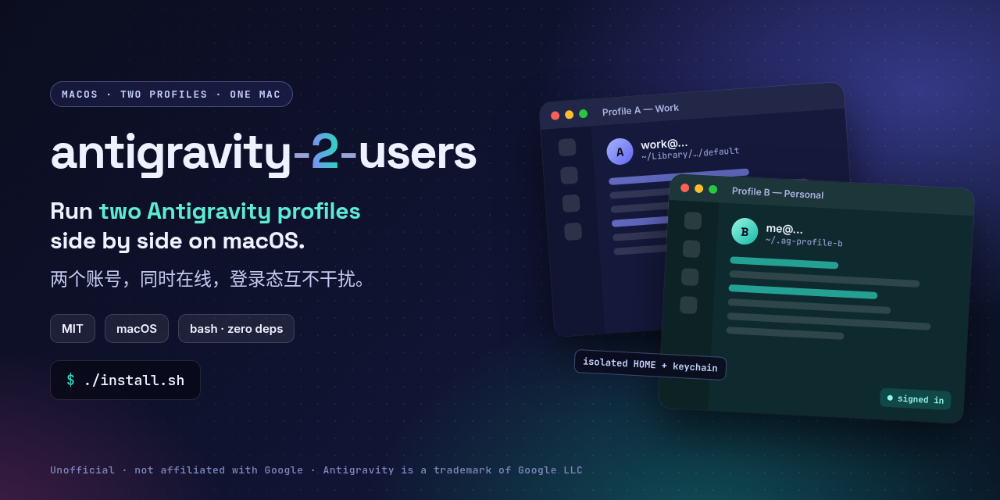

<p align="center">
  
</p>

<h1 align="center">antigravity-2-users</h1>

<p align="center">
  <b>Zwei Antigravity-Profile nebeneinander auf macOS: Arbeitskonto und Privatkonto, beide gleichzeitig angemeldet.</b><br>
  Jedes Profil hat ein eigenes HOME, ein eigenes <code>--user-data-dir</code> und einen eigenen Schlüsselbund, dazu einen Starter im Dock. Reines Bash, keine Abhängigkeiten, MIT-Lizenz.
</p>

<p align="center">
  <a href="https://github.com/Xkongai/antigravity-2-users/actions/workflows/ci.yml"></a>
  <a href="LICENSE"></a>
  
  
</p>

<p align="center">
  <a href="README.md">English</a> | <a href="README.zh-CN.md">简体中文</a> | <a href="README.zh-TW.md">繁體中文</a> | <a href="README.ja.md">日本語</a> | <a href="README.es.md">Español</a> | <a href="README.pt-BR.md">Português (Brasil)</a> | <a href="README.fr.md">Français</a> | <b>Deutsch</b> | <a href="README.ko.md">한국어</a> | <a href="README.ru.md">Русский</a>
</p>

> [!IMPORTANT]
> **Inoffizielles Community-Projekt.** Es steht in keiner Verbindung zu Google und wird von Google weder unterstützt noch empfohlen. „Antigravity“ ist eine Marke der Google LLC und wird hier nur genannt, um anzugeben, mit welcher App dieses Tool funktioniert. Dieses Repository enthält keinen Code, keine Icons und keine sonstigen Assets von Google. Verwende es nur mit Konten, die dir gehören, und halte dich an die Nutzungsbedingungen jedes Kontos, mit dem du dich anmeldest. Nutze es nicht, um Nutzungslimits oder andere Beschränkungen zu umgehen.

## Inhalt

- [Warum](#warum)
- [So funktioniert es](#so-funktioniert-es)
- [Voraussetzungen](#voraussetzungen)
- [Installation](#installation)
- [Verwendung](#verwendung)
- [Optionen](#optionen)
- [Isolation prüfen](#isolation-prüfen)
- [Aktualisieren](#aktualisieren)
- [Deinstallation](#deinstallation)
- [FAQ](#faq)
- [Fehlerbehebung](#fehlerbehebung)
- [Bekannte Einschränkungen](#bekannte-einschränkungen)
- [Sicherheitshinweise](#sicherheitshinweise)
- [Mitwirken](#mitwirken)
- [Lizenz](#lizenz)

## Warum

Die Antigravity-Desktop-App kann immer nur ein Google-Konto angemeldet haben. Die Zugangsdaten liegen im macOS-Schlüsselbund deines Benutzers und in `~/.gemini/`. Startest du eine zweite Instanz nur mit einem anderen `--user-data-dir`, ist sie meist mit **demselben** Konto angemeldet, denn das Backend liest `$HOME` und nicht das Electron-Datenverzeichnis.

Typische Gründe für zwei Profile:

- **Beruf und Privates trennen.** Firmencode, Firmenkonto und von der Firma vorgegebene Erweiterungen in einem Fenster, private Projekte im anderen.
- **Kunden trennen.** Als Freelancer kannst du Workspace, Einstellungen und Verlauf jedes Kunden getrennt halten.
- **Sauber testen.** Neue Erweiterungen, Einstellungen oder Vorabversionen in einem Wegwerf-Profil ausprobieren, ohne deine tägliche Umgebung anzufassen.
- **Unterricht und Demos.** Mit einem sauberen Demo-Konto präsentieren, während dein echtes Konto weiterläuft.

## So funktioniert es

```
                    your Mac (one macOS user)
 ┌──────────────────────────────┬───────────────────────────────────────┐
 │ Antigravity.app (main)       │ "AG Profile B.app" (launcher)         │
 │                              │   └─ runs the SAME Antigravity binary │
 │ HOME = ~                     │ HOME = ~/.ag-profile-b                │
 │ data = ~/Library/Application │ --user-data-dir = ~/.ag-profile-b/    │
 │        Support/Antigravity   │   Library/Application Support/...     │
 │ ~/.gemini, ~/.antigravity    │ ~/.ag-profile-b/.gemini, .antigravity │
 │ keychain: login.keychain-db  │ keychain: ~/.ag-profile-b/Library/    │
 │                              │   Keychains/login.keychain-db         │
 └──────────────────────────────┴───────────────────────────────────────┘
        shared on purpose (symlinks): Desktop · Documents · Downloads
        optional (--link-dev): .gitconfig · .ssh · .zshrc · .zprofile · .npmrc
```

1. **Eigenes HOME.** Der Starter setzt `HOME=~/.ag-profile-<id>`. Alles, was die App unter `~` ablegt (`.gemini`, `.antigravity` samt Erweiterungen, Caches), landet stattdessen dort.
2. **Eigenes Electron-Profil.** `--user-data-dir` zeigt in dieses HOME, damit sind auch Fenster, Einstellungen, Speicher und die Einzelinstanz-Sperre getrennt.
3. **Eigener Schlüsselbund.** Das Installationsskript legt `~/.ag-profile-<id>/Library/Keychains/login.keychain-db` mit einem **zufälligen** Passwort an. Dieses Passwort wird in deinem normalen Anmelde-Schlüsselbund als Eintrag `antigravity-2-users` gespeichert. Der Profil-Schlüsselbund ist so eingestellt, dass er nicht automatisch sperrt, damit die Token-Erneuerung im Hintergrund auch nach dem Ruhezustand weiter funktioniert.
4. **Starter-App.** `osacompile` erzeugt eine kleine AppleScript-App, `AG Profile <ID>.app`. Sie führt `~/.ag-profile-<id>/.ag2u/launch.sh` aus; das Skript entsperrt den Profil-Schlüsselbund und startet dann per `exec` die echte Antigravity-Binärdatei. Das Icon wird bei der Installation lokal aus deinem installierten Antigravity kopiert und nie weiterverbreitet. Die App wird ad hoc signiert und auf Wunsch ins Dock gelegt.

Deine Haupt-Installation von Antigravity wird nie verändert.

## Voraussetzungen

- macOS 13 oder neuer sollte funktionieren (Apple Silicon oder Intel; noch nicht auf echter Hardware getestet), mit den Systemwerkzeugen `bash`, `python3`, `security`, `osacompile` und `codesign`
- Die Antigravity-Desktop-App, standardmäßig unter `/Applications/Antigravity.app`
- Ein Administratorkonto, um nach `/Applications` zu schreiben. Ohne Administratorrechte verwende `--app-dir ~/Applications`.
- Ein zweites Google-Konto zum Anmelden

## Installation

```bash
git clone https://github.com/Xkongai/antigravity-2-users.git
cd antigravity-2-users
./install.sh            # or: ./install.sh --link-dev --name b
```

Was dabei passiert, Schritt für Schritt:

1. Es wird geprüft, ob du macOS nutzt und Antigravity installiert ist.
2. `~/.ag-profile-b` wird angelegt (Rechte 700), und Schreibtisch, Dokumente und Downloads werden hineinverlinkt. Mit `--link-dev` werden auch deine git-, ssh- und Shell-Konfigurationsdateien verlinkt. Echte Dateien werden nie überschrieben, und ein erneuter Durchlauf ist unbedenklich.
3. Ein zufälliges Schlüsselbund-Passwort wird erzeugt und in deinem Anmelde-Schlüsselbund gespeichert; danach wird der Profil-Schlüsselbund angelegt, entsperrt und seine automatische Sperre abgeschaltet.
4. `~/.ag-profile-b/.ag2u/launch.sh` und `config` werden geschrieben, `/Applications/AG Profile B.app` wird erstellt, das Icon kopiert und die App ad hoc signiert.
5. Deine Dock-Einstellungen werden nach `~/.ag-profile-b/.ag2u/dock-backup-*.plist` gesichert, und der Starter wird neben Antigravity eingefügt. Mit `--no-dock` wird dieser Schritt übersprungen.

macOS fragt eventuell einmal, ob `security` den Eintrag `antigravity-2-users` verwenden darf. Wähle **Immer erlauben**.

## Verwendung

1. Öffne **AG Profile B** über das Dock, das Launchpad oder `/Applications`.
2. Beim ersten Start erscheint ein frisches, nicht angemeldetes Antigravity. Melde dich mit deinem zweiten Konto an. Falls der Browser die Anmeldung an das falsche Fenster übergibt, siehe [Anmelde-Rückruf](#die-browser-anmeldung-kehrt-ins-falsche-fenster-zurück).
3. Danach können beide Fenster gleichzeitig offen sein. Jedes behält seine eigene Anmeldung, Einstellungen, Erweiterungen und seinen Verlauf.
4. Um dasselbe Projekt in beiden zu öffnen, nutze in jedem Fenster Ablage → Ordner öffnen. Schreibtisch, Dokumente und Downloads sind von beiden aus sichtbar, und jeder andere absolute Pfad funktioniert ebenfalls.

Du kannst den Starter auch im Terminal ausführen, das hilft beim Debuggen. Zusätzliche Argumente werden an Antigravity weitergereicht:

```bash
./scripts/launch.sh --name b
./scripts/launch.sh --name b ~/Documents/my-project
```

Weitere Profile: `./install.sh --name c` legt `~/.ag-profile-c` und `AG Profile C.app` an.

## Optionen

`install.sh`

| Option | Standard | Bedeutung |
|---|---|---|
| `--name <id>` | `b` | Profil-ID (`a-z`, `0-9`, `-`). Daten liegen in `~/.ag-profile-<id>`, der Starter heißt `AG Profile <ID>.app` |
| `--app-source <path>` | `/Applications/Antigravity.app` | Die zu startende Antigravity-App |
| `--app-dir <dir>` | `/Applications` | Wo der Starter erstellt wird, z. B. `~/Applications` |
| `--no-dock` | aus | Das Dock nicht anfassen |
| `--link-dev` | aus | Zusätzlich `~/.gitconfig`, `~/.ssh`, `~/.zshrc`, `~/.zprofile`, `~/.npmrc` und `~/.config/git` verlinken |
| `-h`, `--help` / `-V`, `--version` | | Hilfe / Version |

`uninstall.sh`

| Option | Bedeutung |
|---|---|
| `--name <id>` | Zu entfernendes Profil (Standard `b`) |
| `--app-dir <dir>` | Wo der Starter erstellt wurde (Standard `/Applications`) |
| `--purge` | Ohne Rückfrage auch Profildaten, den Profil-Schlüsselbund und das gespeicherte Passwort löschen (das Profil wird abgemeldet) |
| `--keep-data` | Nur den Starter und den Dock-Eintrag entfernen |

`scripts/launch.sh [--name <id>] [Antigravity-Argumente…]` und `scripts/verify.sh [--name <id>]` verwenden standardmäßig `b`.

## Isolation prüfen

```bash
./scripts/verify.sh --name b
```

Die Prüfung ist rein lesend und gibt nur **Namen** von Einträgen aus, niemals Geheimnisse:

- laufende Prozesse, die das `--user-data-dir` dieses Profils verwenden
- die Einstellungen des Profil-Schlüsselbunds (sollte `no-timeout` zeigen) und seine Einträge (`svce` / `acct`)
- Antigravity-, Gemini- oder Jetski-Einträge in deinem **Anmelde**-Schlüsselbund
- Dateinamen in `~/.gemini` und in `~/.ag-profile-b/.gemini`

**Was du sehen solltest:** Nach der Anmeldung in Profil B erscheinen dessen Einträge im **Profil**-Schlüsselbund und seine Token-Dateien in `~/.ag-profile-b/.gemini`. Die Einträge deines Hauptkontos bleiben im Anmelde-Schlüsselbund.
Tauchen die Einträge von Profil B stattdessen in deinem Anmelde-Schlüsselbund auf, verwendet macOS auf deinem System den Profil-Schlüsselbund nicht. Bitte [eröffne ein Issue](https://github.com/Xkongai/antigravity-2-users/issues) und gib deine macOS- und Antigravity-Version an. Du kannst es auch von Hand in der **Schlüsselbundverwaltung** prüfen: Ablage → Schlüsselbund hinzufügen … → `~/.ag-profile-b/Library/Keychains/login.keychain-db`.

## Aktualisieren

- **Antigravity-Updates:** Nichts zu tun. Der Starter führt die App aus, die unter `--app-source` liegt. Wirkt das Icon veraltet, führe `./install.sh` erneut aus; das Skript kann beliebig oft laufen und behält deine Anmeldung.
- **Dieses Tool:** `git pull && ./install.sh --name b` mit denselben Optionen wie zuvor. Profildaten und Schlüsselbund werden weiterverwendet.
- **Umstieg vom früheren Prototyp** (`Antigravity Pro 2.app`, `~/.antigravity-pro2-home`): Er verwendete ein festes, öffentlich bekanntes Schlüsselbund-Passwort. Entferne `/Applications/Antigravity Pro 2.app` und sein Dock-Symbol. Danach entweder `~/.antigravity-pro2-home` löschen und dich im neuen Profil neu anmelden, oder den Ordner vor `./install.sh` nach `~/.ag-profile-b` verschieben; dann ersetzt das Installationsskript das alte Passwort durch ein zufälliges.

## Deinstallation

```bash
./uninstall.sh                 # asks whether to delete profile data
./uninstall.sh --keep-data     # remove launcher + Dock entry only
./uninstall.sh --purge         # remove everything for profile b, no questions
./uninstall.sh --name c --purge
```

Beendet werden nur Prozesse, die mit dem `--user-data-dir` dieses Profils gestartet wurden. Dein Haupt-Antigravity, seine Daten und dein Anmelde-Schlüsselbund werden nie angefasst (abgesehen vom Eintrag `antigravity-2-users` bei `--purge`).

## FAQ

**Ist das eine Sandbox?** Nein. Beide Profile laufen unter demselben macOS-Benutzer mit denselben Dateirechten. Getrennt werden **Konten und App-Zustand**; das ist keine Sicherheitsgrenze.

**Vermischen sich die Konten nach einem Neustart?** Das sollte nicht passieren. Jedes Profil liest sein eigenes HOME, sein Datenverzeichnis und seinen Schlüsselbund. Prüfe es mit `verify.sh` auf deinem Rechner.

**Warum sieht Profil B meinen Schreibtisch und meine Dokumente?** Weil sie per Symlink ins Profil-HOME eingebunden sind, damit du deine Projekte öffnen kannst. Alles außerhalb des Profil-HOME ist über absolute Pfade ohnehin erreichbar.

**Git oder SSH funktionieren im Terminal von Profil B nicht.** Dessen HOME enthält weder `.gitconfig` noch `.ssh`. Führe die Installation mit `--link-dev` erneut aus oder richte beides für dieses Konto separat ein.

**`brew`, `node` oder `pyenv` werden nicht gefunden.** Das Profil-HOME hat keine `.zshrc`. Verwende `--link-dev`; der Starter fügt außerdem `/opt/homebrew/bin` und `/usr/local/bin` zum PATH hinzu.

**Gehen mehr als zwei?** Ja, mit einem eigenen `--name` pro Profil.

**Wird Antigravity.app verändert?** Nein. Das Tool liest nur die Binärdatei und kopiert das Icon.

## Fehlerbehebung

### „AG Profile B“ ist beschädigt oder kann nicht geöffnet werden
Signiere den Starter neu und entferne das Quarantäne-Attribut:
```bash
codesign --force --deep --sign - "/Applications/AG Profile B.app"
xattr -dr com.apple.quarantine "/Applications/AG Profile B.app"
```
Oder klicke mit der rechten Maustaste auf die App → Öffnen.

### Der Starter öffnet nichts
Führe `./scripts/launch.sh --name b` im Terminal aus, um Fehler zu sehen. Prüfe, ob `--app-source` auf ein vorhandenes `Antigravity.app` zeigt.

### Das Dock-Symbol fehlt oder ist doppelt
Ziehe die App von Hand aus `/Applications` ins Dock, oder führe die Installation mit `--no-dock` erneut aus. Dock wiederherstellen: `defaults import com.apple.dock ~/.ag-profile-b/.ag2u/dock-backup-<time>.plist && killall Dock`.

### Die Browser-Anmeldung kehrt ins falsche Fenster zurück
Beide Profile sind dieselbe App, deshalb schickt macOS den `antigravity://`-Anmelde-Rückruf an die Instanz seiner Wahl, meist die Haupt-App. Abhilfe:
1. Beende das Haupt-Antigravity, melde dich in Profil B an und öffne danach die Haupt-App wieder. Das ist nur einmal nötig; die Anmeldung bleibt erhalten.
2. Bietet die Anmeldeseite einen Code oder eine URL zum Einfügen in die App an, füge ihn in Profil B ein.

### macOS fragt ständig nach dem Schlüsselbund-Passwort
Wähle **Immer erlauben** für `security` / `antigravity-2-users`. Sperrt der Profil-Schlüsselbund trotzdem, führe `security set-keychain-settings ~/.ag-profile-b/Library/Keychains/login.keychain-db` aus oder starte `./install.sh` erneut.

### Profil B ist plötzlich abgemeldet oder zeigt keine Modelle
Öffne es erneut über den Starter; dabei wird der Schlüsselbund wieder entsperrt. Führe danach `verify.sh` aus. Zeigt der Profil-Schlüsselbund ein Timeout, führe `./install.sh` erneut aus.

## Bekannte Einschränkungen

- **Noch nicht auf echter Hardware getestet.** Die Skripte bestehen shellcheck und wurden während der Entwicklung unter Linux mit simulierten macOS-Werkzeugen komplett durchlaufen. Noch keine Version wurde auf einem echten Mac mit einer aktuellen Antigravity-Version geprüft. Betrachte das Tool als experimentell und berichte, was du beobachtest.
- Es ist **nicht garantiert**, dass macOS die Geheimnisse von Profil B tatsächlich im Profil-Schlüsselbund ablegt, wenn nur `HOME` geändert wird, und das kann je nach macOS-Version unterschiedlich sein. Genau dafür gibt es `verify.sh`.
- Der `antigravity://`-Anmelde-Rückruf kann im falschen Fenster landen (siehe oben).
- Das Schlüsselbund-Passwort wird `security` auf der Kommandozeile übergeben und ist daher für einen Sekundenbruchteil für andere Prozesse deines Benutzers sichtbar.
- Nur macOS. Windows und Linux werden nicht unterstützt.
- Interna von Antigravity (Dateiorte, Anmeldeablauf) können sich mit jedem Update ändern und diesen Ansatz unbrauchbar machen.

## Sicherheitshinweise

- Jeder Profil-Schlüsselbund nutzt ein zufälliges Passwort aus 48 Hexadezimalzeichen, das in deinem eigenen Anmelde-Schlüsselbund liegt. Nichts ist fest im Code hinterlegt, und nichts verlässt deinen Mac.
- Der Profil-Schlüsselbund sperrt nicht automatisch, solange du angemeldet bist. Das hält die Token-Erneuerung am Laufen, bedeutet aber auch, dass ihn nach dem Entsperren jeder Prozess lesen kann, der unter deinem Benutzer läuft. Das ist dasselbe Vertrauensmodell wie bei deinem Anmelde-Schlüsselbund.
- Das Profilverzeichnis wird mit den Rechten `700` angelegt.
- Die Skripte verwenden nie `sudo`, laden nie etwas herunter, ändern außer dem Dock keine Systemeinstellungen (das Dock wird vorher gesichert, und der Schritt lässt sich überspringen) und fassen `Antigravity.app` nie an.
- Lies alle Skripte, bevor du sie ausführst. Sie sind kurz.

Sicherheitsproblem gefunden? Bitte eröffne auf GitHub ein privates Security Advisory statt eines öffentlichen Issues.

## Mitwirken

Issues und PRs sind willkommen, besonders **Testberichte von echten Macs** (macOS-Version, Chip, Antigravity-Version, `verify.sh`-Ausgabe mit geschwärzten E-Mail-Adressen).

- Bleib bei Bash 3.2 (der Version, die macOS mitbringt) und sorge dafür, dass `shellcheck -S style install.sh uninstall.sh scripts/*.sh` fehlerfrei durchläuft.
- Halte die README-Übersetzungen auf dem Stand von `README.md`.
- Keine Google-Assets im Repository.

## Lizenz

[MIT](LICENSE) © 2026 Ai奇异点 (Xkongai)
